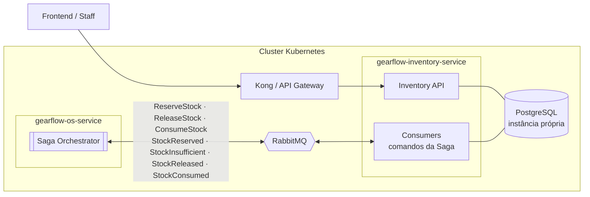
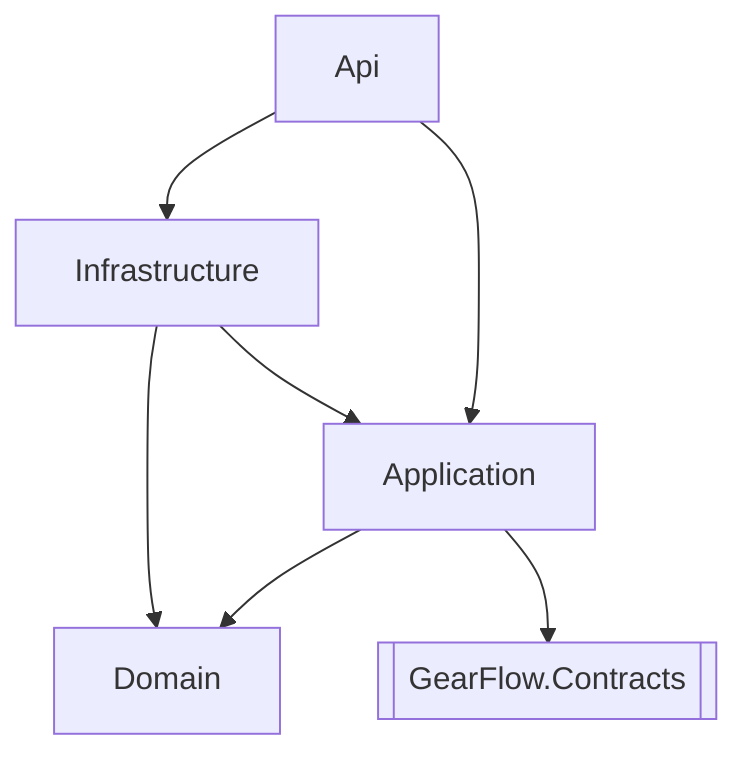
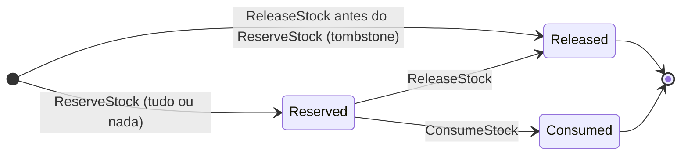

# GearFlow Inventory Service

Microsserviço de **Estoque** do GearFlow (Tech Challenge, Fase 4, 12SOAT).

Responsável por:
- **Catálogo e saldo** de peças (quantidade inteira) e insumos (quantidade fracionária, ex.: litros).
- **Reservar** o estoque de uma OS (tudo ou nada), **liberar** a reserva na compensação da Saga e **consumir** (baixa
  definitiva) depois da execução.
- **Avisar a Saga** do resultado (`StockReserved`, `StockInsufficient`, `StockReleased`, `StockConsumed`) e publicar
  `StockReplenished` e `LowStockAlert`.

> Este serviço é **participante** de uma **Saga orquestrada**. O orquestrador fica no `gearflow-os-service`. O
> Inventory nunca decide o próximo passo do fluxo: executa comandos e responde com eventos.

---

## Status da implementação

| Parte | Estado |
|---|---|
| Domínio (`Part`, `Consumable`, `StockReservation`) | ✅ Pronto e testado |
| Application (CRUD portado do monólito + `ReserveStock`/`ReleaseStock`/`ConsumeStock`) | ✅ Pronto e testado |
| Persistência (EF Core + Npgsql, migrations, concorrência `xmin`, seed com IDs fixos) | ✅ Pronto e **testado contra um PostgreSQL real** (Testcontainers) |
| API REST (13 operações, JWT, ProblemDetails, OpenAPI/Scalar, health, métricas) | ✅ Pronto e testado de ponta a ponta |
| Mensageria (MassTransit 8.5 + RabbitMQ, Outbox/Inbox no EF Core, consumers, retry, DLQ) | ✅ Pronto e **testado com RabbitMQ real** (ver [seção 7](#7-mensageria-rabbitmq--masstransit)) |
| E-mails de estoque (baixo e insuficiente), por SMTP | ✅ Pronto e testado contra um Mailpit real |
| Testes unitários, de arquitetura e de integração | ✅ 215 + 43 |
| BDD (Reqnroll) | ⏳ Fase 7 |
| Imagem no GHCR, CodeQL, varredura de dependências, Dependabot, gate de cobertura (unit + integração) | 🟡 Workflows escritos, **ainda não executados no GitHub** (ver [seção 12](#12-cicd)) |
| SonarCloud, manifests K8s, deploy automático | ⏳ Fase 8 |
| Métricas de negócio, tracing da mensagem do RabbitMQ, dashboard no New Relic, collection Postman | ⏳ Fase 8 |
| Preços em lote para o Operation Service (`A8` do plano) | ⏳ Depende da decisão de onde o Operation lê os preços |

**Como testar, sem depender dos outros serviços:** [`docs/COMO-TESTAR.md`](docs/COMO-TESTAR.md). O simulador do orquestrador
(`tools/GearFlow.Inventory.SagaSimulator`) faz o papel do `os-service`: `dotnet run --project tools/GearFlow.Inventory.SagaSimulator -- scenario all`.

Plano completo: `PLANO-INVENTORY-SERVICE.md` (na raiz do workspace GearFlow).

---

## 1. Visão geral



**Regras de fronteira**
- O Inventory **só** acessa o próprio banco. Nunca lê o banco da OS, do Billing ou do Operation.
- Os itens a reservar **chegam na mensagem** (`ReserveStock`). O Inventory não consulta outros serviços.
- A comunicação com os outros serviços é pelo **RabbitMQ**. O REST é para o frontend e para a consulta de preços.

---

## 2. Papel na Saga

| Passo | Comando (do orquestrador) | Ação local | Sucesso | Falha | Compensação |
|---|---|---|---|---|---|
| 6 | `ReserveStock` | Cria a `StockReservation [Reserved]` e reserva **todos** os itens ou nenhum | `StockReserved` | `StockInsufficient` (lista todos os itens faltantes; não grava nada) | `ReleaseStock` |
| comp. | `ReleaseStock` | Devolve o reservado ao disponível; reserva `Released` | `StockReleased` | — | Idempotente |
| 7b | `ConsumeStock` | Baixa definitiva do reservado; reserva `Consumed`; avalia o mínimo | `StockConsumed` (+ `LowStockAlert`) | Retry e DLQ | *(ponto sem volta)* |
| — | *(REST)* `PATCH …/stock` | Repõe o estoque | `StockReplenished` | — | — |

Decisões e comportamento fino (idempotência, mensagem fora de ordem, concorrência) estão nos ADRs
[0002](docs/adr/0002-reserva-por-os-idempotente-e-concorrencia.md) e [0003](docs/adr/0003-baixa-de-estoque-comandada-pela-saga.md).

**Garantias**
- **Atomicidade**: estoque + reserva + mensagens do Outbox no mesmo commit (handler: mutar, publicar, **depois** `SaveChanges`).
- **Tudo ou nada**: faltou saldo em qualquer item, nada é reservado.
- **Idempotência**: a reserva é única por OS (`service_order_id`). Mensagem repetida só reenvia a resposta.
- **Mensagem fora de ordem**: `ReleaseStock` antes do `ReserveStock` grava um tombstone; o `ReserveStock` atrasado é ignorado.
- **Concorrência**: `xmin` do Postgres como token; a segunda reserva concorrente falha, é repetida e responde `StockInsufficient`.

---

## 3. Tecnologias

| Item | Escolha |
|---|---|
| Runtime | **.NET 10** / ASP.NET Core (Minimal API) |
| Banco | **PostgreSQL** (instância própria), EF Core 10 + Npgsql |
| Mensageria | RabbitMQ + **MassTransit 8.5.x** (Apache-2.0; a 9.x é comercial) com Outbox/Inbox no EF Core ([ADR-0004](docs/adr/0004-masstransit-8-com-outbox-no-ef-core.md)) |
| E-mail | SMTP (Mailpit em dev) |
| CQRS | `IDispatcher` próprio (sem MediatR), decorators de validação e log |
| Validação | FluentValidation |
| Erros | `Result<T>`/`Error` no domínio e na Application; ProblemDetails (RFC 9457) na borda |
| Docs da API | OpenAPI + Scalar (`/scalar/v1`) |
| Observabilidade | Serilog, OpenTelemetry (traces + métricas), `/metrics`, agente New Relic no Dockerfile |
| Testes | xUnit, FluentAssertions, NSubstitute, NetArchTest, MassTransit Test Harness, Testcontainers (Postgres, RabbitMQ, Mailpit), coverlet |

---

## 4. Estrutura

```
gearflow-inventory-service/
├── src/
│   ├── GearFlow.Contracts/               # mensagens da Saga (records). Vira o pacote compartilhado
│   ├── GearFlow.Inventory.Domain/        # regras puras: Core/, Stock/, Reservations/, Repositories/
│   ├── GearFlow.Inventory.Application/   # CQRS: Parts/, Consumables/, Reservations/, Behaviors/, Abstractions/
│   ├── GearFlow.Inventory.Infrastructure/# EF Core/Npgsql, Dispatcher, Messaging/ (MassTransit, consumers), Email/, seed, migrations
│   └── GearFlow.Inventory.Api/           # Minimal API, JWT, health, OpenAPI, Dockerfile
├── tests/
│   ├── GearFlow.Inventory.UnitTests/     # Domain/, Application/, Infrastructure/, Api/, Architecture/
│   └── GearFlow.Inventory.IntegrationTests/ # Persistence/, Messaging/, Rest/, Email/ (Testcontainers)
├── tools/GearFlow.Inventory.SagaSimulator/  # simula o orquestrador: publica os comandos e mostra as respostas
├── scripts/New-DevToken.ps1              # gera um JWT de desenvolvimento para chamar a API na mão
├── docs/adr/                             # decisões de arquitetura
├── .github/workflows/                    # ci.yml, codeql.yml, docker-publish.yml (+ dependabot.yml)
├── docker-compose.yml                    # postgres (porta 5433), rabbitmq, mailpit
├── coverlet.runsettings
├── Directory.Build.props · Directory.Packages.props
└── GearFlow.Inventory.slnx
```



| Camada | Pode | Não pode |
|---|---|---|
| **Domain** | Regras e invariantes do estoque e da reserva, transições de estado | Conhecer EF, HTTP, RabbitMQ ou `GearFlow.Contracts` |
| **Application** | Handlers (carregar, chamar o domínio, publicar, commitar), validators, DTOs | Conhecer EF, Npgsql ou MassTransit; ter regra de negócio que é da entidade |
| **Infrastructure** | EF/Npgsql, Dispatcher, publisher, seed | Decidir regra de negócio |
| **Api** | Receber HTTP, autenticar, montar o command/query e despachar | Acessar repositório ou banco |

Essas regras são **testadas** (`tests/.../Architecture`): o build quebra se alguém violar.

---

## 5. Modelo de domínio



- `Part` / `Consumable`: `Quantity` é o **disponível**; `ReservedQuantity` é o que está preso a OS.
  `Reserve` move disponível → reservado, `Release` desfaz, `Consume` baixa o reservado, `AddQuantity` repõe.
  Mínimo de estoque: 5 (peças e insumos). Preço em centavos.
- `StockReservation`: uma por OS, com as linhas reservadas (item, nome no momento da reserva, quantidade).

---

## 6. Banco de dados

PostgreSQL, database `gearflow_inventory`, schema `inventory`, **instância própria** ([ADR-0001](docs/adr/0001-postgresql-em-instancia-propria.md)).

| Tabela | Conteúdo |
|---|---|
| `parts` | Peças (`quantity` = disponível, `reserved_quantity`), `xmin` como token de concorrência |
| `consumables` | Insumos (`numeric(18,3)`), `xmin` como token de concorrência |
| `stock_reservations` | Uma por OS (`service_order_id` **único**), status em texto, `xmin` |
| `stock_reservation_lines` | Linhas da reserva (PK composta: reserva, tipo, item) |
| `OutboxMessage`, `OutboxState`, `InboxState` | Outbox e Inbox do MassTransit, na **mesma transação** do estoque |

As migrations são aplicadas no startup (`MigrateAsync`, idempotente).

---

## 7. Mensageria (RabbitMQ + MassTransit)

**Filas que o serviço consome** (convenção `<serviço>-<comando>`; a DLQ de cada uma é `<fila>_error`):

| Fila | Mensagem | O que faz |
|---|---|---|
| `inventory-reserve-stock` | `ReserveStock` | Reserva tudo ou nada → `StockReserved` ou `StockInsufficient` |
| `inventory-release-stock` | `ReleaseStock` | Compensação → `StockReleased` |
| `inventory-consume-stock` | `ConsumeStock` | Baixa definitiva → `StockConsumed` (+ `LowStockAlert`) |
| `inventory-low-stock-alert-email` | `LowStockAlert` | E-mail de estoque baixo |
| `inventory-stock-insufficient-email` | `StockInsufficient` | E-mail de estoque insuficiente (o orquestrador consome o mesmo evento, na fila dele) |

O orquestrador pode **publicar** o comando ou fazer **`Send` para `queue:inventory-reserve-stock`**: as duas formas chegam, porque cada fila também é ligada à
exchange do tipo da mensagem. Os tipos (`GearFlow.Contracts:ReserveStock` etc.) precisam ser os mesmos dos dois lados.

**Eventos que o serviço publica** (padrão do grupo, igual ao do Operation: prefixo = repo sem `gearflow-` e sem `-service`, fato em kebab-case):

| Evento | Exchange RabbitMQ |
|---|---|
| `StockReserved` | `inventory.stock-reserved` |
| `StockInsufficient` | `inventory.stock-insufficient` |
| `StockReleased` | `inventory.stock-released` |
| `StockConsumed` | `inventory.stock-consumed` |
| `StockReplenished` | `inventory.stock-replenished` |
| `LowStockAlert` | `inventory.low-stock-alert` |

São nomes de **exchange** (fanout durável do MassTransit), não routing keys de uma exchange topic compartilhada. O envelope, a URN
(`urn:message:GearFlow.Contracts:<Tipo>`) e o payload não mudam: o nome no broker é independente do namespace. Cada serviço interessado mantém a **sua própria
fila durável** ligada à exchange. Fonte única dos nomes: `GearFlow.Contracts.InventoryEventNames.All` (sem dependência de MassTransit); o Inventory aplica o mapa
em `ConfigureInventoryEventNames`, e comandos e tipos do framework (`Fault<T>`) continuam com o nome padrão.

**Receber o pacote não renomeia a topologia sozinho.** Quem consome (ex.: o `os-service`) configura o mesmo nome, por tipo, antes dos endpoints:

```csharp
// Dentro de UsingRabbitMq, antes de ConfigureEndpoints/ReceiveEndpoint:
cfg.Message<StockReserved>(message => message.SetEntityName(InventoryEventNames.All[typeof(StockReserved)]));
// Repetir para cada evento consumido. O consumer segue tipado (IConsumer<StockReserved>).
```

Quem ficou ligado só ao nome antigo (`GearFlow.Contracts:StockReserved`) não recebe os eventos novos.

**Como as garantias da Saga são cumpridas**

| Garantia | Mecanismo |
|---|---|
| Responder só se o estoque foi gravado | **Outbox** (`OutboxMessage`): a resposta entra na transação do consumer e só sai para o broker depois do commit |
| Mensagem entregue duas vezes | **Inbox** (`InboxState`, por `MessageId`) descarta a repetição; e a idempotência do domínio cobre o mesmo comando com outro `MessageId` |
| Publicação feita por um endpoint HTTP (`PATCH …/stock`) | **Outbox do bus** (`UseBusOutbox`): vai para a tabela junto com o saldo |
| Falha transitória (banco fora, conflito de concorrência) | **Retry** de 3 tentativas (1s, 5s, 15s, configurável) e depois a fila `_error` |
| Falha permanente (mensagem malformada, reserva inexistente, liberar o já consumido) | `PermanentMessageException`: **direto para a `_error`**, sem gastar tentativas |
| Duas OS disputando a última unidade | Conflito (`xmin` ou falha de serialização `40001`) → retry → a segunda recebe `StockInsufficient`. **Nunca saldo negativo** |
| Correlação com a OS | `CorrelationId` da mensagem = `ServiceOrderId`, preservado no envelope (provado em teste) |

O `/health/ready` checa o banco e o bus do MassTransit. Com o RabbitMQ fora ele fica **`Degraded` (HTTP 200)**: a API REST continua
servindo e as publicações ficam retidas na tabela do Outbox. Quando o broker volta, o serviço se recupera sozinho (sem reiniciar) e entrega o que
ficou retido, cerca de 30 s depois nas medições locais. Com o **banco** fora, o `/health/ready` devolve 503.

---

## 8. API REST

Docs: `GET /scalar/v1` (interface) e `GET /openapi/v1.json`. Todas as rotas exigem JWT (`Authorization: Bearer`).

| Método | Rota | Descrição |
|---|---|---|
| GET | `/api/inventory/parts` | Lista as peças |
| GET | `/api/inventory/parts/{id}` | Busca uma peça |
| POST | `/api/inventory/parts` | Cadastra uma peça |
| PUT | `/api/inventory/parts/{id}` | Atualiza uma peça |
| DELETE | `/api/inventory/parts/{id}` | Remove (409 se houver unidades reservadas) |
| PATCH | `/api/inventory/parts/{id}/stock` | Repõe estoque e publica `StockReplenished` |
| GET/POST/PUT/DELETE/PATCH | `/api/inventory/consumables…` | Mesmas operações para insumos |
| GET | `/api/inventory/reservations/service-order/{serviceOrderId}` | Reserva de uma OS (status e linhas) |
| GET | `/health/live` · `/health/ready` · `/health` | Probes do K8s (o ready checa o banco e o RabbitMQ) |
| GET | `/metrics` | Prometheus |

As **12 rotas de peças e insumos são as mesmas do monólito**, então o frontend e o Kong não mudam de contrato.
Reservar, liberar e consumir **não** são REST: são comandos da Saga.

---

## 9. Configuração

| Variável | Exemplo | Descrição |
|---|---|---|
| `ConnectionStrings__Postgres` | `Host=…;Database=gearflow_inventory;Username=…;Password=…` | Postgres do Inventory (Secret do K8s) |
| `Jwt__Secret` | *(secret, ≥ 32 caracteres)* | Mesma chave HMAC do monólito e da Lambda de CPF |
| `Jwt__Issuer` / `Jwt__Audience` | `GearFlow.Api` / `GearFlow.Client` | Os mesmos do cluster |
| `RabbitMq__Host` / `__Port` / `__VirtualHost` | `rabbitmq` / `5672` / `/` | Broker (padrão: `localhost:5672`) |
| `RabbitMq__Username` / `__Password` | *(secret)* | Credenciais do broker |
| `RabbitMq__RetryIntervalsMilliseconds__0..n` | `1000`, `5000`, `15000` | Intervalos do retry de falha transitória. **Ao configurar, informe a lista inteira**: ela substitui o padrão |
| `Smtp__Host` / `__Port` / `__From` | `mailpit` / `1025` / `no-reply@gearflow.com` | SMTP dos avisos de estoque |
| `Stock__AlertEmail` | `estoque@gearflow.com` | Quem recebe os avisos de estoque baixo e insuficiente |
| `Seed__EnableDevData` | `true` | Semeia o catálogo de demonstração fora do ambiente Development |
| `Otlp__Endpoint` | `http://…:4317` | Destino OTLP dos traces e métricas (New Relic) |
| `NEW_RELIC_APP_NAME` | `GearFlow.Inventory.Api` | Nome no New Relic (já no Dockerfile) |
| `Seq__ServerUrl` | `http://seq:5341` | Opcional |

Em Development, `appsettings.Development.json` já traz a connection string e um `Jwt:Secret` **só de desenvolvimento**.

---

## 10. Como rodar localmente

Pré-requisitos: .NET 10 SDK e Docker.

```bash
# 1. dependências (Postgres na porta 5433, RabbitMQ, Mailpit)
docker compose up -d

# 2. API (aplica a migration e semeia o catálogo de demonstração)
dotnet run --project src/GearFlow.Inventory.Api
```

| O quê | URL |
|---|---|
| Scalar (docs) | http://localhost:5081/scalar/v1 |
| Postgres | `localhost:5433` (`gearflow` / `gearflow_dev`) |
| RabbitMQ UI | http://localhost:15672 (guest/guest) |
| Mailpit | http://localhost:8025 |

> O Postgres do compose usa a porta **5433** no host para não colidir com um Postgres local na 5432.

Com a API no ar, rode os cenários da Saga (reserva, falta de estoque, compensação, alerta de estoque baixo, mensagem fora de ordem, DLQ) e
confira cada resultado no RabbitMQ, no Mailpit e no Postgres, como descreve o [guia de testes](docs/COMO-TESTAR.md):

```bash
dotnet run --project tools/GearFlow.Inventory.SagaSimulator -- scenario all
```

Para gerar uma migration nova: `dotnet tool restore` e depois
`dotnet ef migrations add <Nome> --project src/GearFlow.Inventory.Infrastructure --startup-project src/GearFlow.Inventory.Api --output-dir Persistence/Migrations`.

### Catálogo de demonstração (IDs fixos)

O seed cria 10 peças e 7 insumos com **GUIDs fixos** (`DemoCatalogIds`), para o seed do `os-service` e do
`operation-service` apontarem para os mesmos itens:

| Item | ID |
|---|---|
| Peças | `a1000000-0000-0000-0000-0000000000NN` (NN = 01 a 10) |
| Insumos | `b2000000-0000-0000-0000-0000000000NN` (NN = 01 a 07) |
| **Jogo de palhetas** (4 un., abaixo do mínimo) | `a1000000-0000-0000-0000-000000000010` |
| **Água desmineralizada** (4 L, abaixo do mínimo) | `b2000000-0000-0000-0000-000000000007` |

Os dois últimos servem para forçar `StockInsufficient` na demo (cenário "pagou, faltou estoque").

---

## 11. Testes e cobertura

```bash
# unitários e de arquitetura (rápidos, sem Docker)
dotnet test tests/GearFlow.Inventory.UnitTests -c Release

# integração (precisa do Docker rodando: o Testcontainers sobe Postgres, RabbitMQ e Mailpit sozinho)
dotnet test tests/GearFlow.Inventory.IntegrationTests -c Release

# com cobertura (como no CI)
dotnet test tests/GearFlow.Inventory.UnitTests -c Release --settings coverlet.runsettings --collect:"XPlat Code Coverage"
```

**Unitários (215)**

| Grupo | O que cobre |
|---|---|
| `Domain` | Estoque bifásico de peça e insumo, `StockReservation` (transições e idempotência), ids e erros |
| `Application` | Handlers da Saga (tudo ou nada, idempotência, mensagem fora de ordem, `LowStockAlert`), CRUD, validators, e-mails |
| `Infrastructure` | Dispatcher + decorators, mapeamento EF/Npgsql, consumers no test harness do MassTransit, grafo de DI, classificação dos erros de concorrência, **convenção de nomes** (exchanges `inventory.<fato>` dos eventos, filas `inventory-<comando>`, e todo evento novo precisa de nome) |
| `Api` | Tradução `Result` → HTTP, middleware de exceções (409 em conflito de concorrência) |
| `Architecture` | Direção das camadas, handlers `internal sealed`, endpoints documentados e protegidos, rotas do monólito preservadas |

Os handlers rodam sobre o **domínio real**, com repositórios em memória (sem mocks no domínio).

**Integração (43), contra Postgres, RabbitMQ e Mailpit reais**

| Grupo | O que prova |
|---|---|
| `Persistence` | Migrations do zero, seed idempotente com IDs fixos, repositórios, **duas reservas da última unidade não commitam as duas** (`xmin` e transações Serializable), índice único por OS, reserva + mensagem do Outbox no mesmo commit |
| `Messaging` | A API completa com um bus de teste no papel do orquestrador (que configura o nome `inventory.<fato>` de cada evento que consome, como o `os-service` fará; e a exchange do tipo CLR não é mais criada): reserva, insuficiente (tudo ou nada + e-mail), liberação, consumo + alerta, duas OS disputando a última unidade, mensagem repetida (Inbox), `ReleaseStock` antes do `ReserveStock`, mensagem malformada direto na `_error`, `PATCH` publicando pelo Outbox do bus, `/health/ready` com banco e broker |
| `Rest` | O contrato REST do frontend: CRUD de peças e insumos, 400/404/409 com `code` no ProblemDetails, consulta de reserva, OpenAPI com as 13 operações, 401 sem token válido |
| `Email` | `SmtpEmailSender` contra um Mailpit real |

**Meta: ≥ 80% de cobertura de linhas.** Medição mais recente (unitários, integração e a união das duas, sem migrations, `Program.cs` e código gerado):

| | Linhas |
|---|---|
| Unitários | 90,7% |
| Integração | 68,8% |
| **Unitários + integração** | **96,3%** |

O CI aplica o gate de 80% sobre os **unitários** e roda a integração em job separado. Ficam fora da cobertura (`coverlet.runsettings`):
`Program.cs`, migrations e o projeto de contratos. O que sobra descoberto são linhas de log dos decorators e ramos de erro raros.

Evidências: `docs/coverage/` *(a gerar a partir do relatório do CI)*.

---

## 12. CI/CD

`.github/workflows/ci.yml`, quatro jobs:
- **unit**: restore → build → testes unitários e de arquitetura com cobertura → **gate de 80%** → publica o relatório.
- **integration**: testes de integração com Testcontainers (o runner `ubuntu-latest` já tem Docker) → publica a cobertura.
- **security**: `dotnet list package --vulnerable --include-transitive` (falha se houver CVE) e relatório de pacotes obsoletos.
- **coverage**: junta os relatórios de unit e integration com o ReportGenerator, aplica o **gate de 80% de linhas** sobre o
  total, comenta o resultado no PR e publica o relatório consolidado (`coverage-merged`), que serve de evidência do desafio.
  É o número do serviço inteiro, o que o PDF pede ("cobertura mínima de 80% por serviço").

Outros workflows:
- `codeql.yml`: análise estática de C# (push, PR e varredura semanal).
- `docker-publish.yml`: build da imagem (`src/GearFlow.Inventory.Api/Dockerfile`) em PR e push no
  `ghcr.io/<org>/gearflow-inventory-service` em `main`, `develop` e tags `v*`.
- `dependabot.yml`: NuGet e GitHub Actions, semanal. O MassTransit não sobe de major (a 9.x é comercial).

Esses workflows ainda **não rodaram no GitHub**; o primeiro run é a validação de verdade. O `docker build` do Dockerfile
foi validado localmente (a imagem tem o agente New Relic e a API), e os 207 + 42 testes passam.

Faltam, na fase 8: SonarCloud (quality gate), deploy automático no Kubernetes e smoke test em `/health/ready`.
A `main` (e a `develop`) precisam ser protegidas nas configurações do GitHub (*Settings → Branches*): PR obrigatório e
checks obrigatórios `Build + testes unitários + cobertura`, `Integração (Postgres + RabbitMQ + Mailpit)`,
`Security (pacotes vulneráveis e obsoletos)`, `Cobertura consolidada (gate 80%)` e `Analyze (csharp)`.

---

## 13. Origem no monólito

Código migrado do BC `Inventory` do `gearflow-app` (ADR-001/002 do monólito):

| Monólito | Aqui | Mudança |
|---|---|---|
| `Inventory.Domain/Aggregates/Part`, `Consumable` | `Domain/Stock/*` | + `Release`, guard em `Consumable.Consume`, `EnsureCanBeRemoved`, criação com id fixo |
| `Shared.Domain` (`Entity`, `Result`, `Error`…) | `Domain/Core/*` | Sem domain events nem MediatR |
| `Inventory.Application` (12 handlers MediatR) | `Application/Parts/*`, `Consumables/*` | `Handle` → `HandleAsync`, `IUnitOfWork`, publica pelo `IMessagePublisher` antes do commit |
| `Workshop.Application/IInventoryReservation` + `Workshop.Infrastructure/SqlInventoryReservation` (SQL cru) | `Application/Reservations/*` | **Reescrito sobre o domínio**, com `StockReservation`, idempotência e concorrência otimista |
| `PartsReplenishedHandler` (auto-resume, no Workshop) | — | Vira lógica do orquestrador no `os-service` (reage a `StockReplenished`) |
| `LowStockAlertIntegrationEvent` publicado pelo Workshop | `LowStockAlert` publicado pelo Inventory no `ConsumeStock` | Agora quem publica é o dono do estoque |
| Endpoints em `Host/GearFlow.Api/Endpoints/Inventory` | `Api/Endpoints/*` | Mesmas rotas; `ISender` → `IDispatcher` |
| `LowStockAlertHandler` e `StockMissingNotificationHandler` (BC Notifications) | `Application/Notifications/*` + consumers em `Infrastructure/Messaging` | E-mail disparado por mensagem, em fila própria (SMTP fora do ar nunca atrasa nem desfaz a baixa), com o destinatário configurável (`Stock__AlertEmail`) |
| `DevDataSeeder` (parte de estoque) | `Infrastructure/Seed/InventorySeeder` | GUIDs fixos |
| Migration `InitialInventory` (SQL Server) | Migration nova (Postgres) | Regenerada |
| SQL Server | PostgreSQL | [ADR-0001](docs/adr/0001-postgresql-em-instancia-propria.md) |

### Pontos de atenção herdados (mantidos de propósito)

- `UpdatePart`/`UpdateConsumable` (PUT) sobrescrevem o **disponível** direto e sem validação, como no monólito. Isso
  pode divergir de reservas ativas. O token `xmin` ao menos impede a perda de uma atualização concorrente.
- O alerta de estoque baixo só dispara no **consumo**, não na reserva (regra do monólito).
- Item inexistente numa reserva aparece no `StockInsufficient` como `Available = 0` e nome "Item não encontrado".
  O orquestrador vai esperar reposição de um item que não existe até o timeout; vale validar os ids antes, no `os-service`.

---

## 14. Decisões de arquitetura (ADRs)

| ADR | Decisão |
|---|---|
| [0001](docs/adr/0001-postgresql-em-instancia-propria.md) | PostgreSQL em instância própria |
| [0002](docs/adr/0002-reserva-por-os-idempotente-e-concorrencia.md) | Reserva por OS, idempotente e com concorrência otimista (`xmin`) |
| [0003](docs/adr/0003-baixa-de-estoque-comandada-pela-saga.md) | Baixa de estoque comandada pela Saga (`ConsumeStock`). **Proposta** |
| [0004](docs/adr/0004-masstransit-8-com-outbox-no-ef-core.md) | MassTransit 8.5.x (Apache-2.0) com Outbox/Inbox no EF Core; falha permanente vai direto para a DLQ |
| — | CQRS com `IDispatcher` próprio e `Result<T>` (sem MediatR, sem exceção de regra de negócio) |
| — | Minimal API + OpenAPI/Scalar (as rotas do monólito ficam intactas) |

---

**Time GearFlow, 12SOAT, Fase 4.**
